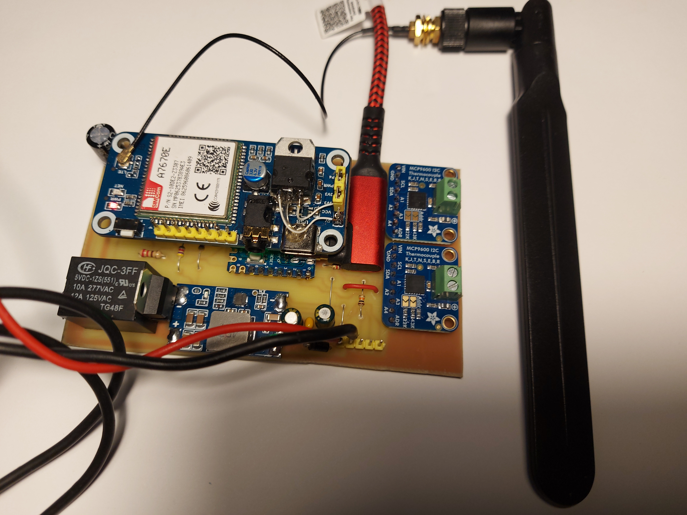

# Mondeo DPF Tracker

[Polski](README.pl.md)

Mondeo DPF Tracker records DPF operation in a Ford Mondeo MK4 2.0 TDCi.
It measures exhaust temperature and differential-pressure sensor voltage,
records dosing-pump and glow-plug transitions, and sends telemetry through an
LTE modem to MQTT. The data helps reconstruct the factory regeneration cycle
and develop a controller for another vehicle.

The physical tracker uses a Waveshare RP2040-Zero. A NUCLEO-G474RE profile is
provided for STM32 build checks.
Firmware uses [JaszczurHAL](https://github.com/jaszczurtd/JaszczurHAL) and an
external Credentials library for secrets. The bundled template lets you build that 
library with your own values.

## Start here

- [Build, Credentials setup and upload](docs/BUILDING.md)
- [Wiring, sensors and status LED](docs/HARDWARE.md)
- [MQTT payloads, timing and queue limits](docs/TELEMETRY.md)
- [Manual A7670E MQTT/TLS test](docs/A7670E.en.md)
- [Backend installation, database and read-only API](backend/README.md)
- [Credentials library reference](Credentials/README.md)

The backend stores raw and normalized messages in PostgreSQL, groups device
boots into sessions, builds analytical windows and exposes a read-only HTTP
API. Visualization and automatic regeneration detection are planned.

Both firmware queues live in RAM. Long outages can fill them, and restarting
the tracker loses queued data. Pressure is reported as voltage until sensor
calibration is available; see the telemetry guide for timing limitations.

## Hardware files

The [KiCad project](materials/DPF_tracker/DPF_tracker.kicad_pro),
[schematic](materials/DPF_tracker/DPF_tracker.kicad_sch) and
[schematic PDF](materials/DPF_tracker/DPF_tracker.pdf) are in `materials/DPF_tracker/`.
Firmware wiring is defined in [device_tree.json](device_tree.json).

Author: Marcin "Jaszczur" Kielesinski.
